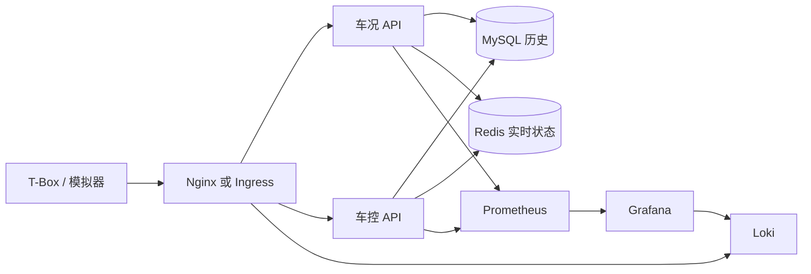

# 架构

上报和车控是两条不同的可靠性要求。

车况可以丢缓存，不能丢历史。`telemetry-api` 先写 MySQL，再写 Redis。缓存失败时接口仍然返回 200，指标记成 `cache_error`，读取时回源 MySQL。就绪探针只检查 MySQL，避免 Redis 抖动时把全部上报副本摘掉。

车控不能只写进数据库就告诉调用方“已经发给车”。指令先以 `pending` 入库，幂等键是 `(vin, idempotency_key)` 的唯一约束。随后写入 Redis Stream，成功后改成 `dispatched`。队列失败时返回 202 和 `queued=false`，同一把幂等键再次请求会把还停在 `pending` 的指令补进队列。就绪探针同时检查 MySQL 和 Redis，副本不健康就从 Service 里摘掉。Deployment 使用 `maxUnavailable: 0`，并用 PodDisruptionBudget 保证至少留一个车控副本。

实时在线车辆数用 Redis ZSET：上报时 `ZADD veh:online`，后台每 10 秒删掉 60 秒以前的成员，再把基数写成 `vehicle_telemetry_online_vehicles`。清理不放在上报请求里。

## 数据

MySQL 三张表，定义在 `deploy/mysql/init/001_schema.sql`。本地集群里的副本是 `deploy/k8s/overlays/local/001_schema.sql`，Kustomize 不能引用 overlay 目录以外的文件，所以两份要一起改。

- `vehicles`：演示里由上报或车控自动补齐，生产里应来自车籍系统。
- `telemetry`：历史。按 `(vin, reported_at)` 查询。
- `control_commands`：指令和回执。

Redis：

- `veh:status:{vin}`：最新车况，24 小时过期。
- `veh:online`：最近心跳。
- `cmd:{id}`：指令热状态。
- `cmd:stream:{vin}`：该车的下行流，近似保留最近 1000 条。

历史表会持续增长。按车辆或月份分区、冷数据进对象存储，不在这套实验里实现。

## 多地域

`infra/terraform/envs/prod.tfvars` 和 `envs/prod-dr.tfvars` 是两个区域各一套 VPC、EKS、RDS、Redis。车况留在本区域。这不是双活：两套数据库互不共享，同一把车控幂等键不能跨区域去重。真要做跨区域车控，需要单独的指令日志和冲突规则，而不是把两套 Terraform 起在不同 region 就叫双活。

## 接入

本地 Nginx 和集群 Ingress 做同一件事：

- `/api/v1/telemetry` 到车况服务
- `/api/v1/commands` 到车控服务
- `/api/v1/vehicles/{vin}/commands` 到车控服务
- 其他 `/api/v1/vehicles/` 到车况服务

车控那条必须更具体。Ingress 使用正则，并依赖 ingress-nginx 按路径长度排序。

指标不经过 Nginx。Prometheus 直接抓 Pod 或 Compose 网络里的 `/metrics`。本地把 18081 和 18082 映射出来只是为了调试。
